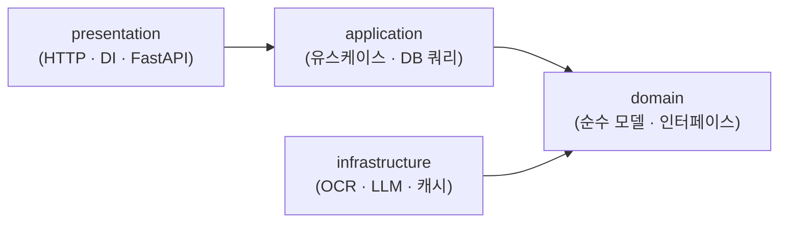
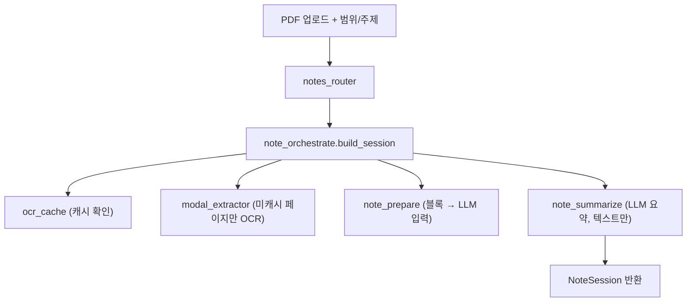

# PDF 개념 요약 노트 모듈

> 스캔한 학습용 PDF(래스터 이미지)에서 **지금 필요한 페이지 범위만 OCR**해, 그 부분을 두고 **AI와 대화하며 사고를 정리**하고, 결과(요약 노트 + 대화)를 **주제별로 보관**해 옵시디언(PKM) vault에 축적한다. 문서를 통째로 분쇄해 검색하는 대신, **필요한 부분만 꺼내 함께 생각한다.**

## 개발 환경

| 구분 | 내용 |
|------|------|
| 백엔드 | Python 3.13 · FastAPI · PyMuPDF · NumPy · SQLite |
| 프런트엔드 | Node 24 · React 18 · TypeScript · Vite |
| 레이아웃 추출 | PaddleOCR-VL — 서버리스 GPU(Modal) / 로컬 / 오프라인 fixture 교체 가능 |
| 요약 LLM | Anthropic Claude (텍스트만 전송) |
| 테스트 | pytest (백엔드) · Playwright (E2E) |
| 개발 OS | macOS |

## 왜 NotebookLM이 아니라 직접 만들었나

Google NotebookLM도 PDF를 넣고 질문할 수 있지만, 다음이 맞지 않았다.

- **용량 제한** — 개인 스캔 PDF는 페이지 전체가 래스터 이미지라 용량이 커서, **NotebookLM의 소스당 200MB 제한을 넘는다**. 통째로 올리는 방식 자체가 막힌다.
- **범위 제어** — 문서를 통째로 색인하지 않고, 지금 공부하는 **특정 페이지 범위만** 꺼내 다루고 싶었다. 전체에서 답을 찾는 대신 필요한 부분만 두고 함께 생각한다.
- **소유·축적** — 대화·노트를 앱 안에 가두지 않고, **마크다운으로 내 옵시디언 vault에 축적**해 PKM과 통합한다.
- **스캔·형광펜 대응** — GoodNotes 백업처럼 텍스트 레이어가 없는 스캔 PDF와 픽셀로 평탄화된 형광펜 강조를, 직접 OCR·색 검출로 반영한다.

벡터 색인·검색(Qdrant)은 예정된 후속 모듈이며, 산출물(프론트매터 노트)은 후속 색인이 그대로 소비할 수 있도록 **Qdrant-ready**로 설계했다.

---

## 해결하는 문제

개인이 스캔해 둔 학습 PDF(교재·논문)를 PKM에 요약 정리하려면, 매번 페이지를 눈으로 읽고 손으로 옮겨 적어야 한다. 특히 다음이 번거롭다.

- 스캔 PDF는 **텍스트 레이어가 없거나 품질이 불확실**하다 (GoodNotes 백업은 래스터 이미지라 텍스트 레이어 자체가 없음) → 도구가 **직접 OCR**로 재추출해야 한다.
- 본문·그림·주석이 섞여 있어 **읽기 순서대로 추출**하기 어렵다.
- GoodNotes 백업 등은 **형광펜이 픽셀로 평탄화**되어 "내가 강조한 부분"을 기계가 알 수 없다.
- 개인 문서라 **원문·이미지를 외부 API로 보내는 것이 꺼려진다**.

이 도구는 로컬에서 레이아웃을 추출하고, **추출된 텍스트만** LLM에 보내 요약하며, 형광펜 강조를 색으로 검출해 요약 가중치에 반영한다.

---

## 핵심 기능

- **페이지 범위 + 주제 프롬프트 기반 요약** — `42-44` + "경사하강법" → 프론트매터가 채워진 마크다운 노트 생성
- **로컬 레이아웃 추출** — PaddleOCR-VL로 text/title/figure/table 블록을 읽기 순서로 추출. 그림은 원본 페이지에서 크롭
- **PII 보호** — 이미지·bbox·원문 파일은 외부 미전송. 외부 LLM에는 **추출 텍스트 발췌만** 전달. 로그에 원문 미기록
- **형광펜 색 검출** — PDF 주석이 없으면 렌더 pixmap에서 형광 색 밴드를 검출해 OCR 블록과 교집합. 색→가중치(초록>노랑, 커스텀 가능)로 요약·대화에 반영 (opt-in)
- **대화형 리파인 + 직접 편집** — 후속 프롬프트로 노트를 다듬거나 마크다운을 직접 수정. 두 경로가 같은 상태를 공유하며, undo 지원
- **추출 세트 / 대화 독립 2축** — PDF 아래 "주제별 OCR 범위"와 "주제별 대화"를 외래키 없이 독립 관리. 페이지 OCR 캐시만 공유
- **교체 가능한 추출 엔진** — `LayoutExtractor` 인터페이스로 서버리스 GPU ↔ 로컬 ↔ 오프라인 fixture를 설정만 바꿔 전환
- **묶음 내보내기** — 마크다운 + 그림 파일을 ZIP으로 내려받아 수동으로 vault에 이동

---

## 아키텍처

### 백엔드 — DDD 레이어드

의존 방향: `presentation → application → domain ← infrastructure`



| 레이어 | FastAPI import | 외부 라이브러리 | 역할 |
|--------|:---:|:---:|------|
| `presentation/` | 허용 | 허용 | HTTP 핸들러 · DI · 스키마 변환 |
| `application/` | **금지** | 허용 | 유스케이스 · DB 쿼리 |
| `domain/` | **금지** | **금지** | 순수 모델 · 교체 가능 인터페이스 |
| `infrastructure/` | **금지** | 허용 | OCR · LLM · 캐시 구현체 |

> 파일명만 봐도 역할이 드러나도록 도메인 prefix를 강제한다 (`chat_service.py`, `library_repository.py`, `anthropic_llm_client.py`).

### 요약 노트 생성 흐름



### 설계 결정 하이라이트

| 결정 | 이유 |
|------|------|
| LLM에 **텍스트만** 전송 | PII 보호 — 이미지·bbox·원문 파일 외부 미전송 |
| OCR 결과 **SQLite 캐시** | 동일 PDF 재처리 방지, 페이지 단위 부분 캐시 |
| `fixture_extractor` | 서버리스 GPU 비용 없이 오프라인·결정적 개발/테스트 |
| 형광펜 **색 검출**(평탄화 대응) | GoodNotes 백업은 형광펜을 주석이 아닌 픽셀로 평탄화 → 주석 우선, 없으면 색 밴드 검출. 추출 시 만든 pixmap 재사용(추가 렌더 0회) |
| 색→가중치 **config 주입** | domain은 config 비의존. presentation에서 가중치 주입(설정 변경이 과거 데이터에 비소급) |
| OCR 범위 ↔ 대화 범위 **독립 2축** | 선-OCR 조직화와 질의를 분리. 공유는 페이지 캐시뿐 |

전체 구조·파일 트리·결정 이력은 [`docs/architecture.md`](docs/architecture.md) 참조.

---

## 실행

### 백엔드

```bash
cd backend && python -m venv .venv && source .venv/bin/activate
pip install -r requirements.txt
uvicorn app.main:app --reload        # http://localhost:8000 — /health 로 확인
```

### 프런트엔드

```bash
cd frontend && npm install
npm run dev                          # http://localhost:5173
```

---

## 테스트

```bash
# 백엔드 — pytest (외부 API·GPU는 mock으로 결정적 실행)
cd backend && pytest

# E2E — Playwright (외부 API는 page.route()로 mock)
npm install && npx playwright install chromium
npm run test:e2e
```

---

## 주요 API

| 메서드 | 경로 | 설명 |
|--------|------|------|
| `POST` | `/sessions` | PDF + 범위/주제로 요약 세션 생성 |
| `GET` | `/sessions/{id}/notes` | 생성된 노트 목록 |
| `POST` | `/sessions/{id}/refine` | 대화형 리파인 |
| `POST` | `/sessions/{id}/notes/{note_id}/edit` | 노트 직접 편집 |
| `POST` | `/sessions/{id}/undo` | 되돌리기 |
| `GET` | `/sessions/{id}/export` | 마크다운 + 그림 ZIP 내보내기 |
| `GET` `POST` | `/books/{id}/conversations` | 주제별 대화 목록·생성 |
| `POST` | `/conversations/{id}/messages` | 대화 메시지 전송 |
| `GET` `POST` | `/books` | 라이브러리(책/PDF) 관리 |

---

## 산출물 — 프론트매터 노트

```yaml
---
id: <안정적 고유 ID>
title: <주제/개념 제목>
source: <원본 PDF 파일명>
pages: [42, 43, 44]
topic: <사용자 입력 주제>
tags: []
created: 2026-08-16
---
```

본문에는 요약과 함께 관련 그림이 `![[파일명]]`으로 첨부되어, 옵시디언에 그대로 붙여 넣을 수 있다.

---

## 범위 밖 (후속 모듈)

- Qdrant 벡터 색인/검색, LangChain 질의 — PKS 후속 모듈
- vault 자동 저장, `[[링크]]` 연결, 기존 노트 인식
- 그림 내용의 vision 해석, 다중 사용자/동시성, 모바일 반응형
