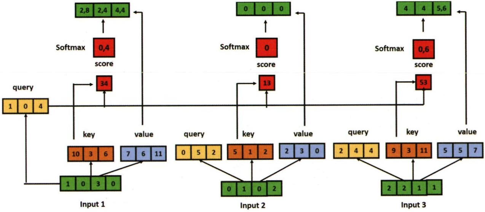

실제로 구현할 때는 단순히 수식을 쓰는 데서 그치지 않고, 큰 값을 다루는 과정에서 발생할 수 있는 수치적 불안정을 피하기 위해 다양한 최적화 기법을 적용한다.

앞 장에서 살펴본 것처럼, 벡터의 길이가 길어질수록 내적 값이 지나치게 커질 수 있다. 이렇게 되면 소프트막스 함수의 입력 값이 너무 커져 확률 질량 probability mass 이 일부 요소에만 쏠리게 된다. 그 결과 기울기가 매우 작아지는 문제가 발생한다. 원 논문에서는 이를 해결하기 위해 내적 결과를 차원 수 D의 제곱근으로 나누어 정규화했다. 이 과정을 흔히 스케일드 닷-프로덕트 어텐션 scaled dot-product attention 이라고 부르며, 현대 LLM의 주요 아키텍처인 트랜스포머 모델에서도 기본 단위로 사용된다.

그림2.5전개된셀프어텐션

셀프 어텐션의 핵심적인 차이는 세 개의 가중치 행렬을 사용한다는 점이다. 바로 쿼리 Q, 키 K, 값 V이다. 이 행렬들은 처음에는 무작위로 초기화된다. Q는 현재 주목하는 대상을 나타내고, K는 모델에 이전 입력에 대한 정보를 제공하며, V는 최종 입력 정보를 추출하는 역할을 한다. 따라서 첫 번째 단계는 입력 X(각 토큰을 벡터로 표현한 배열)에 이 세 행렬을 곱하는 것이다.

 $$ \mathbf{Q}=\mathbf{X}\cdot\mathbf{W}^{Q},\mathbf{K}=\mathbf{X}\cdot\mathbf{W}^{K},\mathbf{V}=\mathbf{X}\cdot\mathbf{W}^{V} $$ 

이 시스템의 뛰어난 점은 동일한 입력으로부터 여러 표현을 동시에 추출할 수 있다는 점이다. 마치 하나의 교과서에서 여러 문제를 찾아낼 수 있듯이, 입력에 대해 다양한 관점의 관계를 학습할 수 있다. 또한 연산을 병렬화할 수 있으므로 멀티헤드 어텐션을 구현할 수 있다. 즉, 같은 입력 문장을 넣더라도 Q, K, V라는 세 가지 서로 다른 관점으로 투영하여 단어 간 관계를 다각도로 바라보게 된다.