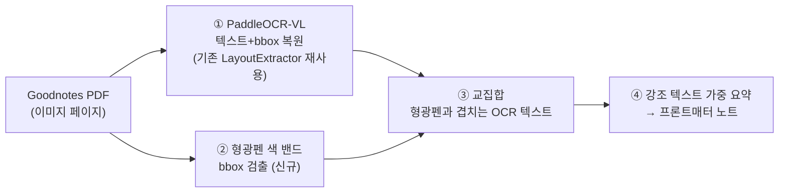

# TODO: 형광펜 기준 PDF 요약 모듈

> 상태: **구현 완료 (Sprint 6, 2026-10-17)** — spec `.claude/harness/spec-sprint6.md`, 계약 `plan-sprint6.md`
> 한 줄: Goodnotes → Google Drive 백업 PDF에서 **사용자가 형광펜 칠한 부분을 참고(가중)해** 요약 노트를 만든다.
>
> 구현 요약: 평탄화 형광펜 색 검출(`highlight_color.py`) + 색상 가중치(초록>노랑, config) + 요약/대화 `use_highlights` 토글 + 프론트 체크박스. 실제 p46에서 노란 밴드 5개 검출 확인. 전체 텍스트 추출은 OCR(Modal) 엔드포인트 필요.

## 배경 / 동기

사용자는 PDF를 Goodnotes로 읽으며 형광펜으로 중요한 곳을 표시한다. "형광펜 친 부분을 중심으로 요약"이 핵심 니즈. 현재 1차 모듈(스캔+OCR PDF 요약)의 자연스러운 확장이며, 문서 소스로 **Google Drive에 백업된 Goodnotes PDF**를 추가하는 성격.

## 실증 완료 사실 (근거 데이터)

`algorithm-interview.pdf`(725p) 46페이지를 PyMuPDF로 직접 검증한 결과:

| 항목 | 결과 | 설계 함의 |
|------|------|----------|
| 형광펜 표시 | 있음 (노란 5줄) | 색 검출로 자동 추출 가능 |
| 저장 방식 | **평탄화된 픽셀** (PDF 주석 아님, annotation 0개) | 주석 파싱 불가 → **색 검출**로 접근 |
| 텍스트 레이어 | **없음** (추출 단어 0개) | 원문 글자 복원하려면 **OCR 필요** |
| 밑 글자 종류 | **인쇄체** (손글씨 아님) | OCR 품질 리스크 낮음 (손글씨 OCR 아님) |
| 색 검출 | 순수 파이썬으로 밴드 5개 자동 검출, 위치 일치 | HSV/RGB 마스킹으로 bbox 추출 실증됨 |

주의: 같은 `GoodNotes/` 폴더라도 **파일마다 레이어 유무가 다르다**.
- `01_빅데이터_강의자료.pdf` → 텍스트 레이어 있음 (인쇄 깨끗, 단 손글씨 필기는 OCR 깨짐)
- `grammar-shock.pdf`, `algorithm-interview.pdf` → 레이어 없는 이미지
→ 런타임에 "레이어 유무"를 판정하는 분기가 필요.

## 설계할 파이프라인

- ①은 기존 `backend/app/domain/extractor.py`의 `LayoutExtractor` 인터페이스 재사용.
- ②~③이 이번 모듈의 신규 핵심.
- ④는 기존 요약 LLM 흐름에 "강조 구간 가중" 프롬프트 반영.

## /plan 전에 결정할 열린 질문

- [ ] **형광펜 색상 범위**: 노랑만? 초록·분홍도? 색별 임계값(HSV) 정의.
- [ ] **입력 UX**: Drive 경로 직접 지정 vs 파일 업로드 vs 둘 다. 페이지 범위 지정 방식.
- [ ] **색 검출 의존성**: numpy/opencv 추가 여부 (현재 backend venv에 numpy 없음 — 순수 파이썬으로도 동작 확인됨).
- [ ] **레이어 유무 분기**: 텍스트 레이어 있으면 OCR 생략하고 기존 bbox 사용할지.
- [ ] **강조 "가중"의 정의**: 형광펜 구간만 요약 vs 전체 요약 + 형광펜 강조 vs 형광펜 구간을 별도 섹션으로.

## 운영 제약 (작업 시 주의)

- **Google Drive 데스크톱 동기 파일**은 클라우드 전용 stub일 수 있음 (`du`가 0B). 열기 전 로컬 materialize("오프라인 사용") 필요.
- **macOS TCC**: `~/Downloads`·Desktop·Documents는 Claude Code 프로세스 접근 차단됨(`Operation not permitted`). 보호 밖 경로로 옮겨야 열림. (이번엔 `~/books/`로 옮겨 해결.)
- **PII**: 개인 문서이므로 이미지·원문은 외부 미전송 원칙 유지 (텍스트만 LLM 전송).

## 다음 액션

1. `/plan` — 위 열린 질문 해소하며 spec.md 작성
2. `/sprint-contract` — 완료 정의 합의
3. 구현 전, 형광펜 색 검출 + OCR bbox 교집합을 샘플 1페이지로 스파이크

## 관련

- 메모리: `~/.claude/.../memory/goodnotes-pdf-findings.md`
- 태스크: TaskList #1
- 아키텍처: [docs/architecture.md](../architecture.md)